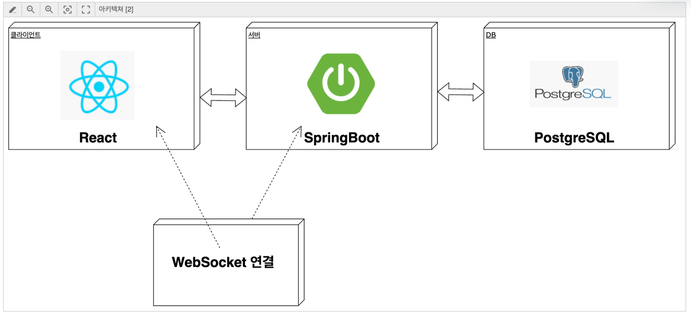
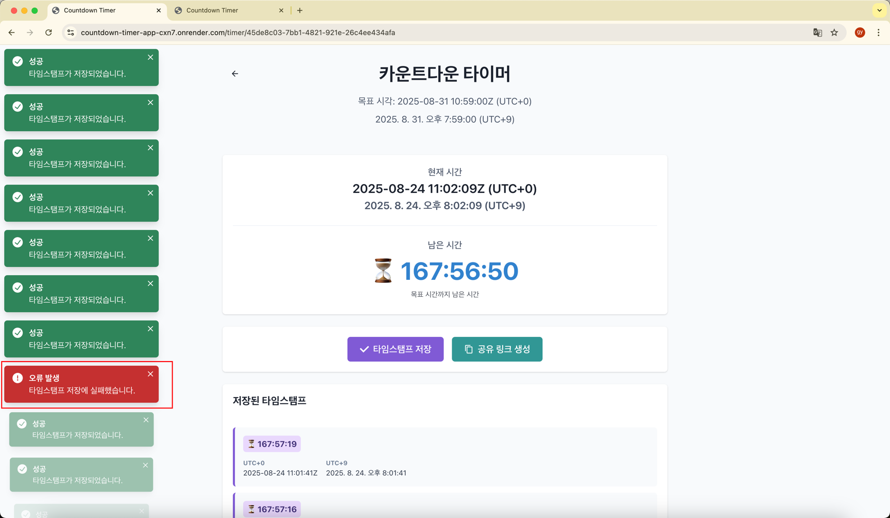
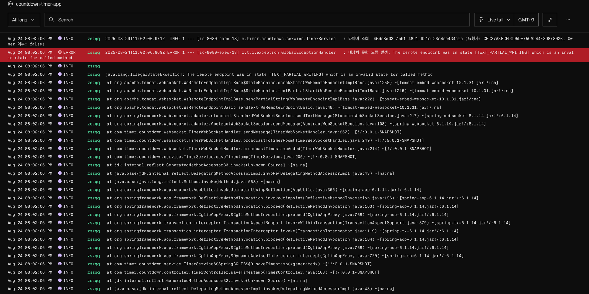
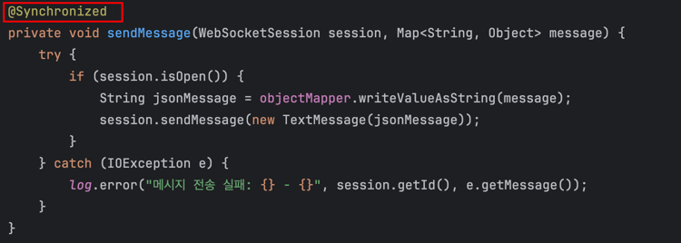
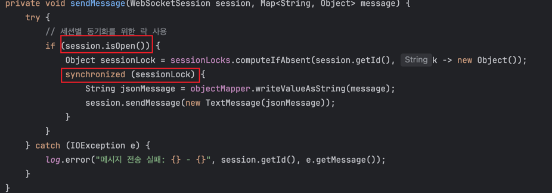

## 카운트다운 타이머 애플리케이션

- 사용자가 기준 시각을 설정하고 해당 시각까지 남은 시간을 실시간으로 표시하고 공유할 수 있는 타이머 시스템입니다.<br>
이 시스템은 공유 링크를 통해 여러 사용자가 같은 기준 시각에 맞춘 타이머를 조회할 수 있으며, 최초 생성자(owner)는 기준 시각을 수정할 수 있습니다.


## 필수 기능
- 기준 시각 설정 및 수정 (소유자만 가능)
- 실시간 카운트다운 표시 (서버의 목표시간과 현재시각 내려주고 남은 시간을 계산하여 표시)
- 공유 링크를 통한 타이머 공유 (URL복사하여 공유하도록 하였음)
- 카운트다운 중 타임스탬프 저장 기능 (타이머가 진행중일때 타이머 저장 버튼을 통해 새로고침후에도 유지되어야 함)
- 저장된 타임스탬프 목록 조회 (모든 사용자들에게도 동일한 타임스탬프를 제공)
- 기준 시각 도달 시 알림 표시 (모든 접속자에게 알림 표시, 타임스탬프 비활성화, 기준시간수정 비활성화)


## 기술 스택

### 백엔드
- Java 17
- Spring Boot 3.2.1
- Spring WebSocket
- MyBatis
- PostgreSQL Database

### 프론트엔드
- React 18
- React Router v6
- Axios (API 호출)
- SockJS (웹소켓 통신)

## 시스템 아키텍처

### 전체 구조


### 백엔드 아키텍처
- **Controller 계층**: REST API 엔드포인트 제공 (타이머 생성, 조회, 수정)
- **Service 계층**: 비즈니스 로직 처리 (타이머 관리, 타임스탬프 저장)
- **Mapper 계층**: MyBatis를 통한 데이터베이스 접근
- **WebSocket 핸들러**: 실시간 타이머 상태 업데이트 및 브로드캐스팅

### 프론트엔드 아키텍처
- **페이지 컴포넌트**: 홈페이지(타이머 생성), 타이머 페이지(타이머 조회/수정)
- **API 모듈**: Axios를 사용한 백엔드 API 호출
- **WebSocket 모듈**: SockJS를 사용한 실시간 데이터 수신

## 데이터베이스 스키마
- `TIMER`: 타이머 (TIMER_ID, TARGET_TIME, OWNER_ID, IS_EXPIRED, CREATED_AT, UPDATED_AT)
- `TIMESTAMP`: 타임스탬프 정보 (ID, TIMER_ID, REMAINING_TIME, CAPTURED_TIME, CREATED_AT)

## 서버-클라이언트 동기화 방식

### 타이머 동기화 원리
1. **서버 시간 기준**: 모든 타이머는 서버의 시간을 기준으로 동작
2. **시간 차이 보정**: 
   - 서버는 타이머 정보와 함께 현재 서버 시간을 전송
   - 클라이언트는 서버 시간과 로컬 시간의 차이를 계산하여 보정값 적용

### WebSocket을 통한 실시간 업데이트
1. **연결 수립**: 클라이언트가 타이머 페이지 접속 시 WebSocket 연결 수립
2. **방 참가**: 타이머 ID를 기반으로 특정 타이머 방에 참가
3. **상태 브로드캐스트**: 
   - 타이머 수정 시 해당 방의 모든 클라이언트에게 업데이트 전파
   - 타임스탬프 저장 시 모든 클라이언트에게 새로운 타임스탬프 전파
4. **만료 알림**: 타이머 만료 시 모든 클라이언트에게 만료 알림 전송

### 세션 관리
- 사용자 식별은 세션 ID 기반 (별도의 로그인 없음)
- 타이머 소유자(생성자)만 타이머 수정 권한 보유
- 세션 ID는 브라우저 로컬 스토리지에 저장되어 재방문 시에도 소유권 유지

## 기술 선택 이유
- 최초 구현을 할 줄 아는 기술로 빠르게 구현 하자 목표
- 구성을 React, Springboot, Mysql로 구현 하였음
- 실제 배포를 위해 DB를 PostgreSQL로 변경 (Render지원)
- **WebSocket 선택 이유**: 
  - 실시간 카운트다운 표시를 위해 서버와 클라이언트 간 양방향 통신 필요
  - HTTP 폴링 방식보다 효율적이고 즉시성 보장
  - 타이머 수정 시 모든 접속자에게 즉시 업데이트 전파 가능
  - 브라우저 호환성이 좋고 구현이 간단함

##  API 엔드포인트

### REST API
- `POST /api/timers` - 새 타이머 생성
- `GET /api/timers/{timerId}` - 타이머 상세 정보 조회
- `PUT /api/timers/{timerId}/target-time` - 타이머 기준 시각 업데이트 (소유자만 가능)
- `POST /api/timers/{timerId}/timestamps` - 타임스탬프 저장

### WebSocket API
- `WS /ws` - 실시간 통신을 위한 WebSocket 연결
  - **연결**: 클라이언트가 `/ws` 엔드포인트로 WebSocket 연결
  - **메시지 타입**:
    - `join`: 타이머 방 참가
    - `leave`: 타이머 방 나가기
    - `ping`: 연결 상태 확인

### API 응답 형식
```json
{
  "success": true,
  "message": "성공 메시지",
  "data": {
    // 실제 데이터
  }
}
```

### WebSocket 메시지 형식
```json
// 클라이언트 → 서버
{
  "type": "join",
  "timerId": "uuid-string"
}

// 서버 → 클라이언트
{
  "type": "targetTimeUpdated",
  "timerId": "uuid-string",
  "targetTime": "2024-01-01T12:00:00Z",
  "serverTime": "2024-01-01T10:00:00Z",
  "remainingSeconds": 7200,
  "isExpired": false
}
```
## 시작 (Docker 환경)

### 1. 전체 애플리케이션 실행

```bash
# 모든 서비스 빌드 및 시작
./start-docker.sh
```

### 2. 수동으로 Docker 실행

```bash
# Docker Compose로 서비스 시작
docker-compose up -d
```

## 시작 (local 환경)
### 1. 로컬 PostgreSQL 데이터베이스 실행

```bash
# PostgreSQL만 시작 (개발용)
docker-compose up -d postgres-db
```

### 2. 백엔드 실행

```bash
# Java 17 이상이 설치되어 있는지 확인
java -version

# 프로젝트 루트 디렉토리에서 실행
./gradlew bootRun
```

애플리케이션은 8088 포트에서 시작됩니다.

### 3. 프론트엔드 실행

```bash
# frontend 디렉토리로 이동
cd src/main/resources/static/frontend

# 종속성 설치
npm install

# 개발 서버 시작
npm start
```

React 앱은 3000 포트에서 시작됩니다.


### 4. 서비스 접속

- **로컬 카운트다운 타이머 앱**: http://localhost:3000 or http://localhost:8088
- 
- **배포되어 있는 카운트다운 타이머 앱**: https://countdown-timer-app-cxn7.onrender.com/


## 실행 문제 발생시
### - PostgreSQL 연결 문제
- Docker 컨테이너가 완전히 시작되었는지 확인
- 포트 5432가 올바르게 매핑되었는지 확인
- 초기화 스크립트가 성공적으로 실행되었는지 확인

### - 메모리 부족
- PostgreSQL은 최소 1GB RAM이 필요합니다
- Docker Desktop의 메모리 할당을 확인

### - 빌드 실패
- Java 17 이상이 설치되어 있는지 확인
- Gradle 래퍼가 실행 가능한지 확인

### - 프로파일 문제
- `application.yml`에서 올바른 프로파일이 활성화되었는지 확인
- 환경 변수 `SPRING_PROFILES_ACTIVE` 설정 확인


### 5. 트러블 슈팅

- Render에서 타임스탬프 저장을 빠른 속도로 계속 누르게 되면 저장에 실패하는 현상 발생

- `TEXT_PARTIAL_WRITING` 에러 발생 동시성 문제를 위한 처리 생각

- WebSocketSession의 경우 Thread-safe 하지 않음 <br>
  즉, 같은 세션에 대해 여러 스레드가 동시에 sendMessage를 호출하면 텍스트 메시지를 다 쓰기 전에 다른 쓰기 작업이 시작돼서 데이터 일관성이 깨져서 `TEXT_PARTIAL_WRITING`와 같이 에러가 발생
- `@Synchronized` 통해서 메서드 단위의 락을 걸어서 하나의 한 스레드만 해당 메서드가 실행되게 수정해서 해결 <BR>
CASE) `A THREAD` 실행중에 sendMessage 실행중 <br>
동시에 들어온 다른 스레드인 `B THREAD`는 `A THREAD` 를 기다리고 처리하므로 한 세션에 순차적으로만 실행
- 하지만 `@Synchronized` 로 메서드 전체를 동기화하니, 한 세션에서 메세지를 보내느 동안 다른 세션도 대기를 해야한다는 문제점

- 세션마다 개별 Lock을 잡고 처리하도록 수정, open된 세션만 동기화 락 처리 
